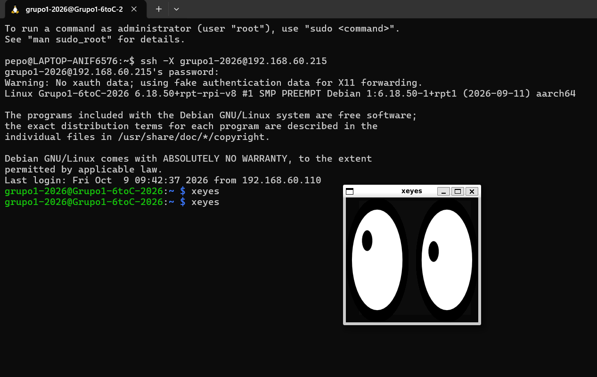
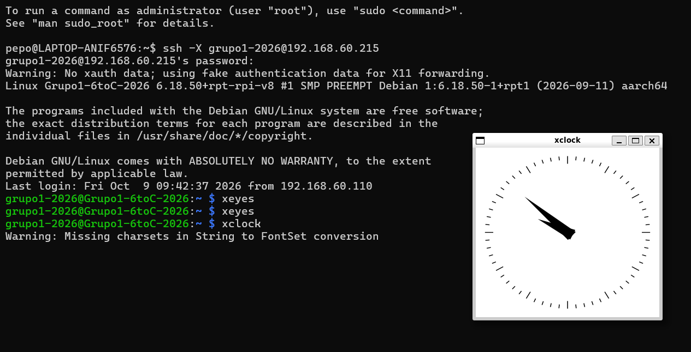
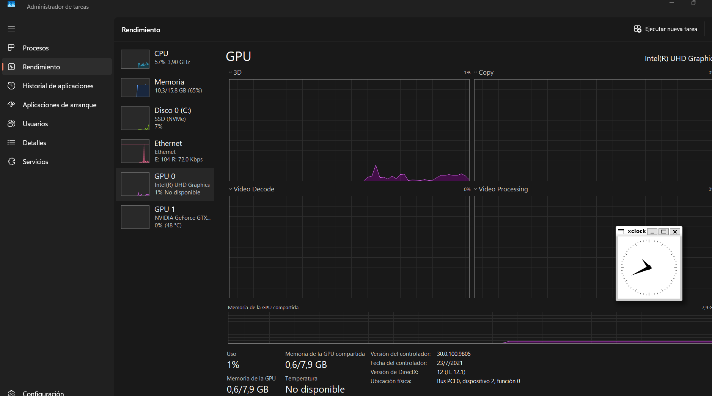

# INFORME INSTALACION XORG - GRUPO 1

#### INTEGRANTES:

-   Vercellone Pedro
-   Baravalle Bautista
-   Corallo Maximo
-   Farah Ignacio
-   Tisano Fabrizio.

#### Profesores Nicolás Falco y Teo Reyna.

**\_\_\_\_\_\_\_\_\_\_\_\_\_\_\_\_\_\_\_\_\_\_\_\_\_\_\_\_\_\_\_\_\_\_\_\_\_\_\_\_\_\_\_\_\_\_\_\_\_\_\_\_\_\_\_\_\_\_\_\_\_\_\_\_\_\_\_\_\_\_\_\_\_\_\_\_\_\_\_\_\_\_\_\_\_\_\_\_\_\_\_\_\_\_\_\_\_\_\_\_\_\_\_\_\_\_\_\_\_\_**

### Indice:

1.  [Introducción](#introducci%C3%B3n)
2.  [Objetivo del informe](#objetivo-del-informe)
3.  [Marco teórico](#marco-te%C3%B3rico)  
    3.1. [El protocolo X11 y el servidor gráfico Xorg](#el-protocolo-x11-y-el-servidor-gr%C3%A1fico-xorg)  
    3.2. [Modelo cliente-servidor en X11](#modelo-cliente-servidor-en-x11)  
    3.3. [Reenvío gráfico mediante SSH (X11 Forwarding)](#reenv%C3%ADo-gr%C3%A1fico-mediante-ssh-x11-forwarding)  
    3.4. [Autenticación y seguridad mediante xauth](#autenticaci%C3%B3n-y-seguridad-mediante-xauth)
4.  [Procedimiento](#procedimiento)  
    4.1. [Instalación de Xorg en la Raspberry Pi](#instalaci%C3%B3n-de-xorg-en-la-raspberry-pi)  
    4.2. [Configuración de X11 Forwarding en SSH](#configuraci%C3%B3n-de-x11-forwarding-en-ssh)  
    4.3. [Reinicio del servicio SSH](#reinicio-del-servicio-ssh)  
    4.4. [Instalación de aplicaciones gráficas en WSL](#instalaci%C3%B3n-de-aplicaciones-gr%C3%A1ficas-en-wsl)  
    4.5. [Conexión SSH con reenvío gráfico](#conexi%C3%B3n-ssh-con-reenv%C3%ADo-gr%C3%A1fico)  
    4.6. [Prueba de aplicaciones gráficas con xclock y xeyes](#prueba-de-aplicaciones-gr%C3%A1ficas-con-xclock-y-xeyes)  
    4.7. [Verificación de procesos con top](#verificaci%C3%B3n-de-procesos-con-top)  
    4.8. [Comprobación del uso de la GPU del cliente](#comprobaci%C3%B3n-del-uso-de-la-gpu-del-cliente)
5.  [Comandos utilizados](#comandos-utilizados)
6.  [Conclusión](#conclusi%C3%B3n)

**\_\_\_\_\_\_\_\_\_\_\_\_\_\_\_\_\_\_\_\_\_\_\_\_\_\_\_\_\_\_\_\_\_\_\_\_\_\_\_\_\_\_\_\_\_\_\_\_\_\_\_\_\_\_\_\_\_\_\_\_\_\_\_\_\_\_\_\_\_\_\_\_\_\_\_\_\_\_\_\_\_\_\_\_\_\_\_\_\_\_\_\_\_\_\_\_\_\_\_\_\_\_\_\_\_\_\_\_\_\_**

## Intalacion de interfaz grafica Xorg

### Fecha: 9 de octubre de 2026

### 1\. Introducción

En este informe vamos a ver como instalar Xorg dentro de la Raspberry Pi, para que utilice los recursos graficos de nuestra computadora pero procesamiento de la misma raspberry.

### 2\. Objetivo del Informe

Queremos lograr que instalando aplicaciones gráficas en la raspberry podamos correrlas por ssh sin que nuestro servidor realice las tareas de procesamiento del video, sino que simplemente se envíen los datos remotamente y podamos generar las ventanas y los gráficos en el host cliente.

### 3\. Marco Teorico

**3.1 El Protocolo X11 y el Servidor Gráfico Xorg**  
El Sistema de Ventanas X (X11) es el estándar de redes y visualización gráfica utilizado en sistemas operativos tipo Unix/Linux. Xorg es la implementación libre y de código abierto de este motor gráfico. Su arquitectura se basa en un modelo Cliente-Servidor de red nativo, lo que significa que la aplicación que procesa los datos y la pantalla que dibuja los gráficos no necesitan estar físicamente en la misma computadora.

**3.2 Inversión del Modelo Cliente-Servidor en X11**  
A diferencia de los servicios web tradicionales (donde el servidor es la máquina remota y el cliente es la PC local), en el protocolo X11 las funciones se definen según quién maneja los recursos de hardware de la interfaz:  
• El Servidor X (X Server): Corre en el Host Cliente (PC con Windows/WSL). Es el encargado de gestionar el hardware gráfico local: renderizar las ventanas en el monitor, procesar los píxeles a través de la tarjeta de video (GPU) y capturar los eventos físicos del teclado y el mouse.  
• El Cliente X (X Client): Es la Raspberry Pi. Es el programa o aplicación (ej. xclock, scripts de Python) que ejecuta la lógica computacional, consume CPU/RAM para procesar datos, pero no dibuja píxeles localmente; en su lugar, envía comandos primitivos de dibujo a través de la red.

**3.3 Reenvío Gráfico mediante Túnel SSH (X11 Forwarding)**  
El reenvío X11 utiliza el protocolo SSH (Secure Shell) como un canal seguro de transporte. Al activar la directiva X11Forwarding yes en el archivo de configuración del demonio SSH (sshd\_config), se habilita un canal de comunicación cifrado (un “túnel”) dentro de la red.  
Cuando el Cliente X (Raspberry Pi) intenta abrir una pantalla virtual (DISPLAY), el tráfico gráfico se encapsula automáticamente dentro de la conexión SSH activa, protegiendo los datos de la interfaz de extremos maliciosos en la red local.

**3.4 Mecanismos de Autenticación y Seguridad (xauth)**  
Dado que el Servidor X local (PC/WSL) acepta conexiones de red externas para dibujar ventanas, implementa un sistema de control de acceso estricto para evitar intromisiones. El protocolo utiliza llaves de seguridad llamadas Cookies de Autorización MIT (MIT-MAGIC-COOKIE-1).  
A través de la utilidad xauth, la Raspberry Pi almacena y presenta esta cookie secreta al conectarse. El Servidor X de la computadora host verifica la firma; si coincide, valida el protocolo y permite el despliegue de las ventanas en el entorno de escritorio de Windows.

**\_\_\_\_\_\_\_\_\_\_\_\_\_\_\_\_\_\_\_\_\_\_\_\_\_\_\_\_\_\_\_\_\_\_\_\_\_\_\_\_\_\_\_\_\_\_\_\_\_\_\_\_\_\_\_\_\_\_\_\_\_\_\_\_\_\_\_\_\_\_\_\_\_\_\_\_\_\_\_\_\_\_\_\_\_\_\_\_\_\_\_\_\_\_\_\_\_\_\_\_\_\_\_\_\_\_\_\_\_\_**

### 4\. Procedimiento

-   Primero, debemos instalar el servidor Xorg puro, sin gestores de ventanas (como Openbox o Mutter) ni entornos de escritorio (como LXDE o Pixel):

**sudo apt update && sudo apt install --no-install-recommends xserver-xorg xauth x11-apps -y**  
sudo: ejecuta el comando con permisos de administrador.

apt update: actualiza la lista de paquetes disponibles en los repositorios.

&&: ejecuta el segundo comando únicamente si el primero finaliza correctamente.

apt install: instala los paquetes especificados.

–no-install-recommends: evita instalar paquetes recomendados que no sean estrictamente necesarios.

xserver\-xorg: instala los componentes del servidor gráfico Xorg.

xauth: instala la herramienta encargada de gestionar las credenciales de autenticación para las conexiones X11.

x11-apps: instala aplicaciones gráficas de prueba, como xclock y xeyes.

\-y: acepta automáticamente las confirmaciones de instalación.

-   Una vez instalado, nos aseguramos de que el archivo /etc/ssh/sshd\_config de la Raspberry tenga la línea X11Forwarding yes activa:
    
-   Abrimos el archivo con:
    

**sudo nano /etc/ssh/sshd\_config**

sudo: permite modificar un archivo del sistema que requiere permisos de administrador.

nano: abre un editor de texto desde la terminal.

/etc/ssh/sshd\_config: es el archivo que contiene la configuración del servidor SSH.

-   y buscamoos la linea que diga: ***X11Forwarding no/yes***
    
-   La ponemos en yes, en caso de que no lo haya estado. Al ponerlo en yes, lo que hacés es prender el interruptor para que la Raspberry Pi permita viajar datos visuales adentro del cable de red virtual de SSH. Por defecto, SSH está configurado en no por seguridad. Esto significa que solo te deja enviar y recibir texto puro y comandos de consola. Esto hace que:
    

1.  **Crea un puente de video**: Le avisa al sistema SSH que, además de comandos de texto, va a pasar información del servidor gráfico Xorg que acaban de instalar.
2.  **Crea una pantalla virtual (DISPLAY)**: Abre un canal secreto dentro de la Raspberry. Cuando vos ejecutes una aplicación gráfica (como el reloj o un navegador), el programa no va a buscar un monitor físico HDMI, sino que va a mandar los datos de su ventana directamente a ese canal de SSH.
3.  **Manda los datos de forma segura**: SSH empaqueta y cifra esos datos gráficos junto con el texto y se los manda a tu computadora con WSL.

-   Posteriormente, reiniciamos el servicio SSH:

**sudo systemctl restart ssh**

sudo: ejecuta la operación con permisos de administrador.

systemctl: permite administrar los servicios del sistema.

restart: reinicia el servicio indicado.

ssh: identifica el servicio SSH que se debe reiniciar.

-   Ahora sí, cuando nos conectamos desde WSL con ssh -X usuario@ip\_de\_la\_raspberry y ejecutamos xclock, la Raspberry usará su propio servidor Xorg instalado para procesar la estructura de la ventana, pero enviará los datos de los gráficos para que se dibujen en el host cliente(laptop).
    
-   Posteriormente, en nuestra laptop, antes de conectarnos a a la raspberry por SSH, instalamos las aplicaciones de prueba en tu WSL:
    

**sudo apt update && sudo apt install x11-apps -y**

Este comando actualiza la lista de paquetes e instala las aplicaciones gráficas de prueba en el entorno WSL de la computadora cliente. Estas herramientas permiten comprobar si el reenvío gráfico funciona correctamente.

Sus parámetros son los mismos que los explicados en el primer comando, pero en este caso se instala únicamente el paquete x11-apps.

-   Luego nos cenectamos a la raspberry con:

**ssh -X [grupo1-2026@192.168.60.215](mailto:grupo1-2026@192.168.60.215)**

ssh: inicia una conexión remota segura mediante el protocolo SSH.

\-X: habilita el reenvío gráfico X11, permitiendo visualizar en la computadora cliente las ventanas de las aplicaciones ejecutadas remotamente.

grupo1-2026: es el nombre del usuario con el que se inicia sesión en la Raspberry Pi.

@: separa el nombre de usuario de la dirección del equipo remoto.

192.168.60.215: es la dirección IP de la Raspberry Pi a la que se desea conectar.

-   Y comprobamos la conectividad utilizando los programas xclock y xeyes:

 

-   Para asegurarnos de que al correr Xclock estemos usando el procesador de la Raspberry, en nuestra terminal WSL, corremos:

**xclock &** (& hace que corra en segundo plano para poder seguir usando la terminal)

esto corre el xclock y tambien nos devuelve “\[1\] 2832”, que es el numero de puerto que esta utilizando.

-   Luego hacemos el comando

**top**

El comando top muestra los procesos que se están ejecutando en el sistema, junto con información sobre el consumo de CPU y memoria.

que nos muestra los procesos que se estan corriendo en la raspberry, y cuando vamos al puerto 2832, vemos esto.

**2832 grupo1\-+ 20 0 14856 7464 6248 S 0.0 0.8 0:00.10 xclock**

-   Asi, asegurandonos de que estamos usando el procesador de la Raspberry.
    
-   Tambien comprobamos que estamos usando el procesador de nuestra laptop ya que al abrir el administrador de tareas, ir a rendimiento de GPU, podemos ver aumentos de consumo de la GPU cuando abrimos o movemos la pestaña de el reloj.
    

**\_\_\_\_\_\_\_\_\_\_\_\_\_\_\_\_\_\_\_\_\_\_\_\_\_\_\_\_\_\_\_\_\_\_\_\_\_\_\_\_\_\_\_\_\_\_\_\_\_\_\_\_\_\_\_\_\_\_\_\_\_\_\_\_\_\_\_\_\_\_\_\_\_\_\_\_\_\_\_\_\_\_\_\_\_\_\_\_\_\_\_\_\_\_\_\_\_\_\_\_\_\_\_\_\_\_\_\_\_\_**

### 5\. Comandos utilizados

**1\. Actualización e instalación de Xorg en la Raspberry Pi**

`sudo apt update && sudo apt install --no-install-recommends xserver-xorg xauth x11-apps -y`

-   `sudo`: ejecuta el comando con permisos de administrador.
-   `apt update`: actualiza la lista de paquetes disponibles en los repositorios.
-   `&&`: ejecuta el segundo comando únicamente si el primero finaliza correctamente.
-   `apt install`: instala los paquetes especificados.
-   `--no-install-recommends`: evita instalar paquetes recomendados que no sean estrictamente necesarios.
-   `xserver-xorg`: instala los componentes del servidor gráfico Xorg.
-   `xauth`: instala la herramienta que gestiona las credenciales de autenticación para las conexiones X11.
-   `x11-apps`: instala aplicaciones gráficas de prueba, como xclock y xeyes.
-   `-y`: acepta automáticamente las confirmaciones de instalación.

**2\. Edición de la configuración de SSH**

`sudo nano /etc/ssh/sshd_config`

-   `sudo`: ejecuta la operación con permisos de administrador.
-   `nano`: abre un editor de texto desde la terminal.
-   `/etc/ssh/sshd_config`: es el archivo que contiene la configuración del servidor SSH.

Dentro de este archivo, se habilita la directiva `X11Forwarding yes`, que permite reenviar aplicaciones gráficas a través de una conexión SSH.

**3\. Reinicio del servicio SSH**

`sudo systemctl restart ssh`

-   `sudo`: ejecuta la operación con permisos de administrador.
-   `systemctl`: permite administrar los servicios del sistema.
-   `restart`: reinicia el servicio indicado.
-   `ssh`: identifica el servicio SSH que se debe reiniciar.

Este comando aplica los cambios realizados en la configuración de SSH sin necesidad de reiniciar toda la Raspberry Pi.

**4\. Instalación de aplicaciones gráficas en WSL**

`sudo apt update && sudo apt install x11-apps -y`

Este comando actualiza la lista de paquetes e instala las aplicaciones gráficas de prueba en WSL, el entorno Linux utilizado en la computadora cliente.

-   `sudo`: ejecuta los comandos con permisos de administrador.
-   `apt update`: actualiza la lista de paquetes disponibles.
-   `&&`: ejecuta la instalación si la actualización finaliza correctamente.
-   `apt install x11-apps`: instala las aplicaciones gráficas de prueba.
-   `-y`: acepta automáticamente las confirmaciones de instalación.

**5\. Conexión a la Raspberry Pi mediante SSH**

`ssh -X grupo1-2026@192.168.60.215`

-   `ssh`: inicia una conexión remota segura.
-   `-X`: habilita el reenvío gráfico X11 para mostrar las ventanas de las aplicaciones remotas en la computadora cliente.
-   `grupo1-2026`: es el nombre del usuario con el que se inicia sesión en la Raspberry Pi.
-   `@`: separa el nombre de usuario de la dirección IP del equipo remoto.
-   `192.168.60.215`: es la dirección IP de la Raspberry Pi.

Una vez establecida la conexión, las aplicaciones gráficas ejecutadas en la Raspberry Pi pueden mostrar sus ventanas en la computadora cliente, siempre que el entorno gráfico esté correctamente configurado.

**6\. Ejecución de xclock en segundo plano**

`xclock &`

-   `xclock`: ejecuta una aplicación gráfica que muestra un reloj analógico.
-   `&`: ejecuta el proceso en segundo plano, permitiendo seguir utilizando la terminal.

Al ejecutar el comando, la terminal devuelve un identificador de trabajo y un número de proceso (PID). Este último permite identificar la ejecución de xclock.

**Importante:** el número devuelto no es un puerto, sino el PID del proceso.

**7\. Visualización de los procesos en ejecución**

`top`

El comando `top` muestra los procesos que se están ejecutando en el sistema y permite observar su consumo de CPU y memoria RAM.

Entre los datos que presenta se encuentran:

-   `PID`: identificador del proceso.
-   `USER`: usuario que ejecuta el proceso.
-   `%CPU`: porcentaje de CPU utilizado.
-   `%MEM`: porcentaje de memoria RAM utilizado.
-   `COMMAND`: nombre del programa en ejecución.

Se utiliza para comprobar que el proceso xclock se ejecuta en la Raspberry Pi y consume los recursos de procesamiento de ese equipo.

Para salir de `top`, se presiona la tecla `q`.

**8\. Ejecución de xeyes**

`xeyes`

El comando `xeyes` abre una aplicación gráfica que muestra dos ojos que siguen la posición del cursor del mouse.

Se utiliza como prueba adicional para comprobar el funcionamiento del reenvío gráfico X11. Si la conexión está configurada correctamente, la ventana aparecerá en la computadora cliente, aunque la aplicación se ejecute en la Raspberry Pi.

**\_\_\_\_\_\_\_\_\_\_\_\_\_\_\_\_\_\_\_\_\_\_\_\_\_\_\_\_\_\_\_\_\_\_\_\_\_\_\_\_\_\_\_\_\_\_\_\_\_\_\_\_\_\_\_\_\_\_\_\_\_\_\_\_\_\_\_\_\_\_\_\_\_\_\_\_\_\_\_\_\_\_\_\_\_\_\_\_\_\_\_\_\_\_\_\_\_\_\_\_\_\_\_\_\_\_\_\_\_\_**

### 6\. Conclusión

A través de este trabajo, logramos instalar y configurar Xorg en la Raspberry Pi y habilitar el reenvío gráfico mediante SSH. De esta manera, pudimos ejecutar aplicaciones gráficas como xclock y xeyes y visualizar sus ventanas en nuestra laptop, utilizando procesamineto de la Raspberry pero procesamiento de video de nuestra GPU. Además, comprobamos que los procesos de las aplicaciones se ejecutan en la Raspberry Pi mediante el comando top, mientras que la GPU de nuestra computadora presenta actividad al interactuar con las ventanas.