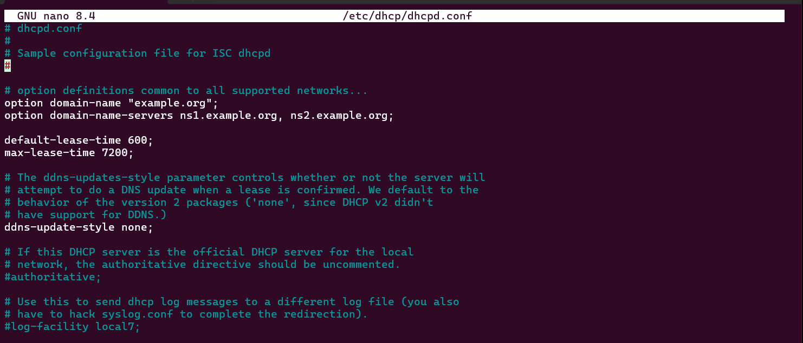
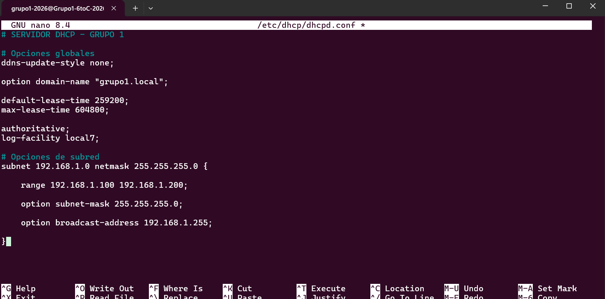
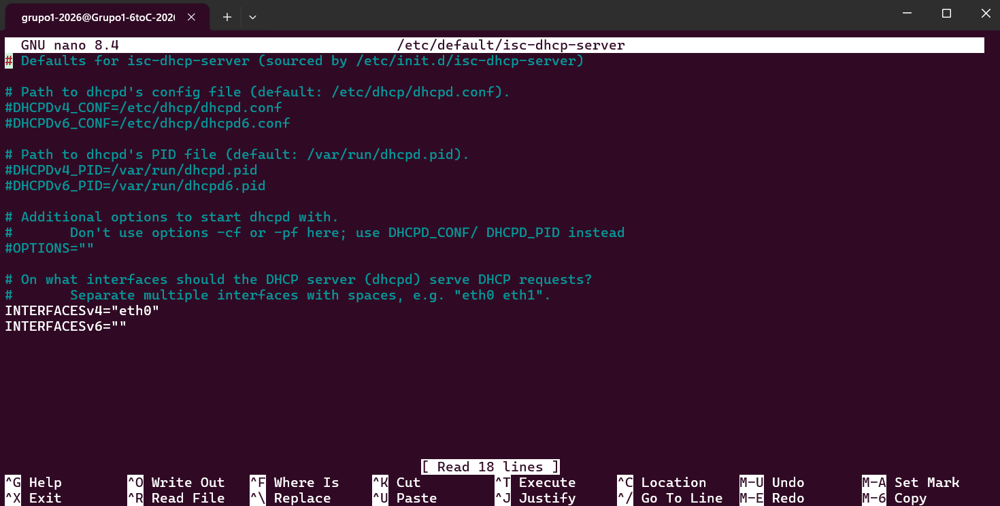
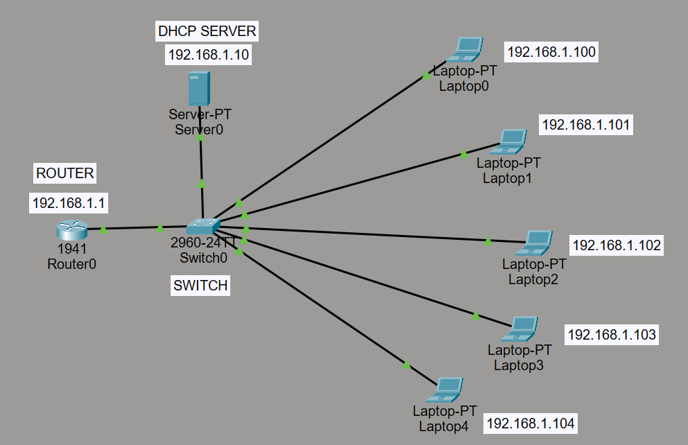
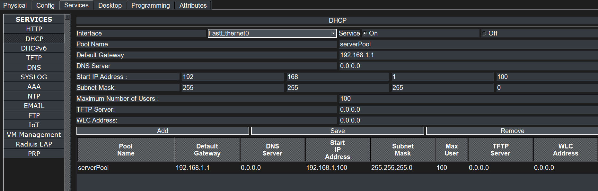

# INFORME SERVIDOR DHCP - GRUPO 1

#### INTEGRANTES:

- Vercellone Pedro
- Baravalle Bautista
- Corallo Maximo
- Farah Ignacio
- Tisano Fabrizio.

#### Profesores Nicolás Falco y Teo Reyna.

---

### Indice:

1. [Introducción](#1-introducción)

2. [Objetivo del Informe](#2-objetivo-del-informe)

3. [Marco Teórico](#3-marco-teórico)
   3.1. [DHCP y su funcionamiento](#31-dhcp-y-su-funcionamiento)
   3.2. [Modelo cliente-servidor y proceso DORA](#32-modelo-cliente-servidor-y-proceso-dora)
   3.3. [Direcciones IP, máscara y concesiones](#33-direcciones-ip-máscara-y-concesiones)
   3.4. [Raspberry Pi, switch y red LAN](#34-raspberry-pi-switch-y-red-lan)

4. [Procedimiento](#4-procedimiento)

   4.1. [Conexión por SSH y planificación de la red](#41-conexión-por-ssh-y-planificación-de-la-red)
   4.2. [Asignación de IP fija a la Raspberry Pi](#42-asignación-de-ip-fija-a-la-raspberry-pi)
   4.3. [Instalación de isc-dhcp-server](#43-instalación-de-isc-dhcp-server)
   4.4. [Configuración de dhcpd.conf](#44-configuración-de-dhcpdconf)
   4.5. [Selección de la interfaz Ethernet](#45-selección-de-la-interfaz-ethernet)
   4.6. [Inicio y verificación del servicio](#46-inicio-y-verificación-del-servicio)
   4.7. [Configuración de Windows y comprobación de DHCP](#47-configuración-de-windows-y-comprobación-de-dhcp)

5. [Diseño de la red en Packet Tracer](#5-diseño-de-la-red-en-packet-tracer)

6. [Comandos utilizados](#6-comandos-utilizados)

7. [Conclusión](#7-conclusión)

---

## Instalación y configuración de un servidor DHCP

### Fecha: 23 de octubre de 2026

### 1. Introducción

En este informe vamos a explicar cómo instalamos y configuramos un servidor DHCP en nuestra Raspberry Pi para que asigne direcciones IP automáticamente a las notebooks del grupo. La red LAN está formada por un switch al que se conectan la Raspberry y las computadoras. También se detallan las pruebas que realizamos desde Windows para comprobar que el servidor entrega correctamente la configuración de red.

### 2. Objetivo del Informe

Queremos lograr que la Raspberry Pi funcione como servidor DHCP principal de la red LAN del grupo 1, cuya dirección de red es **192.168.1.0/24**. Para eso, debemos asignarle una IP fija a la Raspberry, instalar y configurar el servicio DHCP, establecer un rango de direcciones para los clientes y comprobar que una notebook recibe su IP automáticamente. Además, la consigna solicita representar la topología de red en Cisco Packet Tracer.

### 3. Marco Teórico

**3.1 DHCP y su funcionamiento**

DHCP (Dynamic Host Configuration Protocol, o Protocolo de Configuración Dinámica de Host) es un protocolo de red que permite asignar automáticamente direcciones IP y otros parámetros a los dispositivos conectados. Así, no es necesario configurar manualmente una dirección distinta en cada notebook. En este trabajo utilizamos `isc-dhcp-server`, un servicio de Linux que permite convertir la Raspberry Pi en servidor DHCP.

**3.2 Modelo cliente-servidor y proceso DORA**

El servidor DHCP es la Raspberry Pi y los clientes son las notebooks. Normalmente, para obtener una dirección IP se realiza el intercambio DORA:

1. **Discover:** el cliente busca servidores DHCP disponibles mediante un mensaje de difusión.
2. **Offer:** el servidor ofrece una dirección IP y parámetros de configuración.
3. **Request:** el cliente solicita utilizar la dirección ofrecida.
4. **Acknowledge (ACK):** el servidor confirma la asignación por un período determinado.

DHCP usa principalmente UDP: puerto 67 para el servidor y puerto 68 para el cliente.

**3.3 Direcciones IP, máscara y concesiones**

Nuestra red es `192.168.1.0` con máscara `255.255.255.0` (`/24`). La Raspberry tiene la dirección fija `192.168.1.1`, mientras que el rango de asignación dinámica va de `192.168.1.100` a `192.168.1.200`. La dirección de broadcast es `192.168.1.255`. La IP `192.168.1.1` no se incluye en el rango dinámico, de manera que los clientes no pueden recibirla por DHCP.

Una **concesión (lease)** es el tiempo durante el cual una computadora puede utilizar la dirección IP asignada. En la configuración final mostrada, el tiempo de concesión predeterminado es de `259200` segundos (3 días) y el máximo es de `604800` segundos (7 días). La comprobación que realizamos anteriormente desde Windows registró una concesión de 10 minutos, correspondiente a la configuración de ese momento; no tenemos una nueva captura de la renovación después de modificar esos tiempos.

**3.4 Raspberry Pi, switch y red LAN**

La Raspberry Pi se conecta por Ethernet al mismo switch que las notebooks. El switch permite la comunicación entre dispositivos de la misma red local, mientras que la Raspberry proporciona el servicio DHCP. Como esta práctica se realiza en una LAN aislada, no es necesario asignar puerta de enlace para verificar la comunicación local. Es importante evitar que otro servidor DHCP esté conectado a la misma LAN de pruebas, porque podría entregar configuraciones distintas.

---

### 4. Procedimiento

**4.1 Conexión por SSH y planificación de la red**

- Primero, nos conectamos desde PowerShell de Windows a la Raspberry Pi por SSH usando el usuario del grupo:

`ssh grupo1-2026@192.168.60.218`

`ssh`: permite administrar remotamente la Raspberry mediante un canal cifrado.

`grupo1-2026`: usuario configurado en la Raspberry.

`192.168.60.218`: dirección IP fija del servidor.

- Definimos la red `192.168.1.0/24` y reservamos `192.168.1.1` para la Raspberry. Las notebooks recibirían direcciones del rango `192.168.1.100` a `192.168.1.200`.

**4.2 Asignación de IP fija a la Raspberry Pi**

- Consultamos el nombre de la conexión Ethernet:

`nmcli connection show`

- Configuramos la conexión cableada con IP manual (si el perfil se llama `Wired connection 1`):

```bash
sudo nmcli connection modify "Wired connection 1" ipv4.method manual ipv4.addresses 192.168.1.1/24 ipv4.gateway "" ipv4.dns ""
sudo nmcli connection up "Wired connection 1"
```

`nmcli`: administra perfiles de red cuando se utiliza NetworkManager.

`ipv4.method manual`: indica que la dirección es fija, y no asignada por DHCP.

`ipv4.addresses 192.168.1.1/24`: establece la dirección y máscara del servidor.

`connection up`: aplica el perfil modificado. Este paso puede cortar una sesión SSH abierta con la IP anterior.

- Para recuperar la comunicación, conectamos la notebook a la misma LAN y le asignamos temporalmente `192.168.1.10/24` mediante Ethernet. Verificamos la conectividad con `ping 192.168.1.1` y volvimos a ingresar por SSH desde PowerShell. En WSL apareció inicialmente `No route to host`, por eso continuamos desde Windows.

**4.3 Instalación de isc-dhcp-server**

- Instalamos el servidor DHCP en la Raspberry Pi:

```bash
sudo apt update
sudo apt install isc-dhcp-server -y
```

`sudo`: ejecuta los comandos con permisos de administrador.

`apt update`: actualiza la lista de paquetes.

`apt install`: instala el programa indicado.

`isc-dhcp-server`: paquete que ofrece el servicio DHCP.

`-y`: confirma automáticamente la instalación.

**4.4 Configuración de dhcpd.conf**

- Abrimos el archivo principal del servidor:

`sudo nano /etc/dhcp/dhcpd.conf`

- En las primeras pruebas, el archivo tenía los valores de ejemplo `example.org`, `default-lease-time 600` y `max-lease-time 7200`. Más adelante lo dejamos con una configuración propia del grupo 1, como se observa en las capturas.



*Figura 1. Contenido inicial del archivo de configuración de DHCP.*

- La configuración final mostrada en el editor fue:

```conf
# SERVIDOR DHCP - GRUPO 1

# Opciones globales
ddns-update-style none;
option domain-name "grupo1.local";
default-lease-time 259200;
max-lease-time 604800;
authoritative;
log-facility local7;

# Opciones de subred
subnet 192.168.1.0 netmask 255.255.255.0 {
    range 192.168.1.100 192.168.1.200;
    option subnet-mask 255.255.255.0;
    option broadcast-address 192.168.1.255;
}
```

`ddns-update-style none`: desactiva las actualizaciones dinámicas de DNS.

`option domain-name "grupo1.local"`: entrega ese dominio de búsqueda a los clientes.

`default-lease-time` y `max-lease-time`: establecen el tiempo predeterminado y máximo de concesión.

`authoritative`: indica que el servidor es responsable de entregar DHCP en esta red.

`log-facility local7`: selecciona una facilidad de registro del sistema.

`subnet`: define la red y su máscara; `range` indica las direcciones que se pueden entregar.

`option broadcast-address`: establece `192.168.1.255` como broadcast de esta LAN.



*Figura 2. Configuración personalizada del servidor DHCP para el grupo 1.*

**4.5 Selección de la interfaz Ethernet**

- Luego abrimos el archivo que indica en qué interfaz atenderá el servidor DHCP:

`sudo nano /etc/default/isc-dhcp-server`

- Configuramos las siguientes líneas:

```conf
INTERFACESv4="eth0"
INTERFACESv6=""
```

`INTERFACESv4="eth0"`: habilita el servicio DHCP IPv4 en la interfaz Ethernet conectada al switch.

`INTERFACESv6=""`: no selecciona interfaces para DHCP IPv6.



*Figura 3. Archivo /etc/default/isc-dhcp-server con la interfaz eth0 seleccionada.*

**4.6 Inicio y verificación del servicio**

- Revisamos la sintaxis del archivo y administramos el servicio con estos comandos:

```bash
sudo dhcpd -t -cf /etc/dhcp/dhcpd.conf
sudo systemctl restart isc-dhcp-server
sudo systemctl enable isc-dhcp-server
sudo systemctl status isc-dhcp-server
```

`dhcpd -t -cf`: verifica la sintaxis de la configuración.

`systemctl restart`: vuelve a iniciar el servicio para aplicar los cambios.

`systemctl enable`: permite que el servicio arranque automáticamente con el sistema.

`systemctl status`: muestra si está activo o si presenta un error.

- Si el servicio no se inicia, se puede revisar el registro mediante `sudo journalctl -u isc-dhcp-server -n 30 --no-pager`. La comprobación posterior desde Windows indica que había un servidor DHCP operativo en `192.168.1.1`.

**4.7 Configuración de Windows y comprobación de DHCP**

- En la notebook, primero utilizamos la IP manual `192.168.1.10/24` para poder recuperar SSH. Luego abrimos las propiedades del adaptador **Ethernet**, ingresamos a IPv4 y seleccionamos **Obtener una dirección IP automáticamente**.

- Desde PowerShell ejecutamos:

```powershell
ipconfig /release
ipconfig /renew
ipconfig /all
ping 192.168.1.1
```

`ipconfig /release`: libera una dirección obtenida por DHCP, si existe una concesión vigente.

`ipconfig /renew`: solicita una nueva concesión al servidor DHCP.

`ipconfig /all`: muestra la configuración completa de los adaptadores, incluido el servidor DHCP.

`ping`: comprueba la comunicación con la Raspberry Pi.

- El resultado real que observamos en el adaptador Ethernet de Windows fue:

```text
DHCP habilitado: Sí
Dirección IPv4: 192.168.1.100
Máscara de subred: 255.255.255.0
Servidor DHCP: 192.168.1.1
Concesión obtenida: 23/10/2026 11:56:03
La concesión expira: 23/10/2026 12:06:03
```

Esto demuestra que nuestra notebook recibió automáticamente la dirección `192.168.1.100` del servidor DHCP de la Raspberry. La puerta de enlace quedó vacía porque la práctica se realiza en la misma red LAN, sin necesidad de salir hacia otras redes. En las primeras pruebas Windows mostró `DHCP habilitado: No`; lo resolvimos activando la asignación automática de IPv4 en Ethernet.

### 5. Diseño de la red en Packet Tracer

Para representar el funcionamiento de nuestra red LAN, utilizamos Cisco Packet Tracer, donde diseñamos una topología con un router, un switch, un servidor DHCP y cinco notebooks.

- **Router 1941:** tiene la IP `192.168.1.1` y funciona como puerta de enlace.
- **Switch 2960:** conecta todos los dispositivos de la red.
- **Server-PT:** tiene la IP fija `192.168.1.10` y funciona como servidor DHCP.
- **Laptop-PT:** representan las cinco notebooks que reciben direcciones IP.



*Figura 4. Topología de nuestra red LAN en Cisco Packet Tracer.*

Luego, ingresamos al servidor y seleccionamos `Services → DHCP`, donde activamos el servicio y configuramos los siguientes parámetros:

- **Pool Name:** `serverPool`
- **Default Gateway:** `192.168.1.1`
- **Start IP Address:** `192.168.1.100`
- **Subnet Mask:** `255.255.255.0`
- **Maximum Number of Users:** `100`



*Figura 5. Configuración del servidor DHCP en Cisco Packet Tracer.*

Después, configuramos las notebooks desde `Desktop → IP Configuration → DHCP` para que reciban automáticamente sus direcciones IP.

En el esquema representamos las siguientes direcciones:

- Laptop0: `192.168.1.100`
- Laptop1: `192.168.1.101`
- Laptop2: `192.168.1.102`
- Laptop3: `192.168.1.103`
- Laptop4: `192.168.1.104`

De esta manera, representamos cómo el servidor DHCP distribuye direcciones IP dentro de una red local.

A diferencia de nuestra implementación física, donde la Raspberry Pi funciona como servidor DHCP con IP `192.168.1.1`, en Packet Tracer utilizamos un servidor independiente con IP `192.168.1.10` y un router como puerta de enlace.

Esta simulación nos permitió visualizar el funcionamiento del protocolo DHCP y complementar el trabajo realizado con la Raspberry Pi.

---

### 6. Comandos utilizados

**1. Conexión remota con la Raspberry**

`ssh grupo1-2026@192.168.1.1`

- `ssh`: acceso remoto cifrado.
- `grupo1-2026`: usuario del grupo.
- `192.168.1.1`: IP de la Raspberry en la LAN.

**2. Consulta y modificación de la conexión Ethernet**

`nmcli connection show`

`sudo nmcli connection modify "Wired connection 1" ipv4.method manual ipv4.addresses 192.168.1.1/24 ipv4.gateway "" ipv4.dns ""`

`sudo nmcli connection up "Wired connection 1"`

- `nmcli`: configura las conexiones administradas por NetworkManager.
- `modify`: modifica el perfil de conexión.
- `ipv4.method manual`: utiliza dirección fija.
- `ipv4.addresses`: establece la IP y el prefijo de red.
- `connection up`: activa el perfil actualizado.

**3. Actualización e instalación del servicio**

`sudo apt update`

`sudo apt install isc-dhcp-server -y`

- `sudo`: permite realizar operaciones administrativas.
- `apt update`: actualiza los índices de paquetes.
- `apt install`: instala un paquete.
- `-y`: acepta las confirmaciones de instalación.

**4. Configuración del rango DHCP**

`sudo nano /etc/dhcp/dhcpd.conf`

- `nano`: editor de texto en terminal.
- `/etc/dhcp/dhcpd.conf`: archivo principal de configuración del servidor DHCP.

**5. Selección de la interfaz**

`sudo nano /etc/default/isc-dhcp-server`

- En este archivo se configuró `INTERFACESv4="eth0"` para atender las solicitudes DHCP por Ethernet.

**6. Validación y reinicio del servicio DHCP**

`sudo dhcpd -t -cf /etc/dhcp/dhcpd.conf`

`sudo systemctl restart isc-dhcp-server`

`sudo systemctl enable isc-dhcp-server`

`sudo systemctl status isc-dhcp-server`

- `dhcpd -t`: revisa la configuración sin iniciar el servidor.
- `systemctl restart`: reinicia el servicio.
- `systemctl enable`: configura el inicio automático.
- `systemctl status`: muestra su estado.

**7. Diagnóstico de problemas**

`sudo journalctl -u isc-dhcp-server -n 30 --no-pager`

- `journalctl`: consulta el registro del servicio para encontrar errores de configuración o arranque.

**8. Renovación y comprobación de la IP en Windows**

`ipconfig /release`

`ipconfig /renew`

`ipconfig /all`

`ping 192.168.1.1`

- `ipconfig /release`: libera una concesión DHCP del cliente.
- `ipconfig /renew`: solicita o renueva su concesión.
- `ipconfig /all`: permite identificar la IP, la máscara y el servidor DHCP.
- `ping`: comprueba que exista conectividad con el servidor.

---

### 7. Conclusión

A través de este trabajo, logramos configurar nuestra Raspberry Pi como servidor DHCP de la LAN del grupo 1. Le asignamos la IP fija `192.168.1.1`, definimos un rango de direcciones de `192.168.1.100` a `192.168.1.200` y habilitamos el servicio sobre la interfaz Ethernet `eth0`. Además, comprobamos desde Windows que la notebook pasó de una IP configurada manualmente a recibir automáticamente la dirección `192.168.1.100`, con servidor DHCP `192.168.1.1`. Esto confirma que la asignación automática de direcciones funciona en nuestra red local. Para finalizar, realizamos  el diagrama correspondiente en Packet Tracer.
