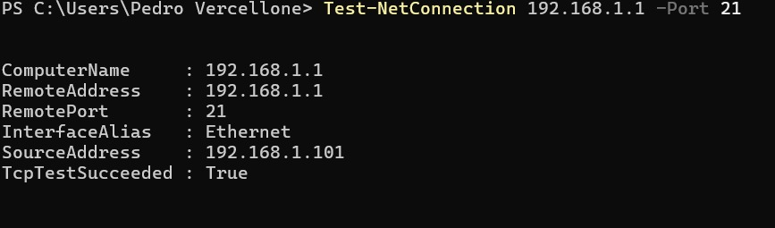
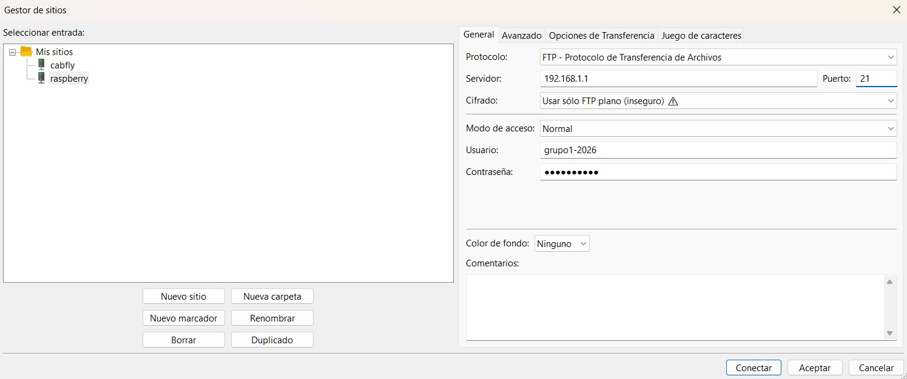
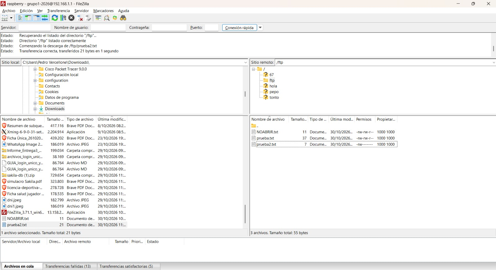

# INFORME SERVIDOR FTP - GRUPO 1

#### INTEGRANTES:

- Vercellone Pedro
- Baravalle Bautista
- Corallo Maximo
- Farah Ignacio
- Tisano Fabrizio.

#### Profesores Nicolás Falco y Teo Reyna.

---

### Índice:

1. [Introducción](#1-introducción)
2. [Objetivo del Informe](#2-objetivo-del-informe)
3. [Marco Teórico](#3-marco-teórico)
   - 3.1. [FTP y su funcionamiento](#31-ftp-y-su-funcionamiento)
   - 3.2. [Modelo cliente-servidor](#32-modelo-cliente-servidor)
   - 3.3. [vsftpd y sus características](#33-vsftpd-y-sus-características)
   - 3.4. [Puertos, modo pasivo y seguridad](#34-puertos-modo-pasivo-y-seguridad)
   - 3.5. [Raspberry Pi y red LAN](#35-raspberry-pi-y-red-lan)
4. [Procedimiento](#4-procedimiento)
   - 4.1. [Preparación de la Raspberry y conexión temporal a Internet](#41-preparación-de-la-raspberry-y-conexión-temporal-a-internet)
   - 4.2. [Instalación de vsftpd](#42-instalación-de-vsftpd)
   - 4.3. [Regreso a la LAN y reactivación de DHCP](#43-regreso-a-la-lan-y-reactivación-de-dhcp)
   - 4.4. [Configuración del servidor FTP](#44-configuración-del-servidor-ftp)
   - 4.5. [Creación de archivos de prueba](#45-creación-de-archivos-de-prueba)
   - 4.6. [Conexión desde FileZilla](#46-conexión-desde-filezilla)
   - 4.7. [Solución de problemas y pruebas de transferencia](#47-solución-de-problemas-y-pruebas-de-transferencia)
5. [Comandos utilizados](#5-comandos-utilizados)
6. [Conclusión](#6-conclusión)

---

## Instalación y configuración de un servidor FTP

### Fecha: 30 de octubre de 2026

### 1. Introducción

En este informe vamos a explicar cómo instalamos y configuramos un servidor FTP en nuestra Raspberry Pi, utilizando el programa `vsftpd`. El objetivo fue que la Raspberry funcionara como servidor de archivos para las notebooks conectadas a la red LAN del grupo 1, permitiendo acceder a carpetas y transferir archivos desde un cliente FTP como FileZilla. También explicamos cómo instalamos el programa sin alterar permanentemente la red local que ya habíamos configurado en el trabajo práctico anterior.

### 2. Objetivo del Informe

Queremos lograr que nuestra Raspberry Pi funcione como servidor FTP dentro de la LAN del grupo 1, con dirección IP fija `192.168.1.1`. Para eso, necesitamos instalar `vsftpd`, configurar el acceso con el usuario local de la Raspberry, habilitar la transferencia de archivos y comprobar la conexión desde una notebook utilizando FileZilla. Además, buscamos mantener funcionando el servidor DHCP que habíamos configurado anteriormente, para que las notebooks puedan obtener una dirección IP automáticamente.

### 3. Marco Teórico

**3.1. FTP y su funcionamiento**

FTP (*File Transfer Protocol*, o Protocolo de Transferencia de Archivos) es un protocolo de red que permite transferir archivos entre equipos. Por medio de un cliente FTP podemos conectarnos a un servidor, consultar archivos y carpetas y, si tenemos los permisos correspondientes, descargar o subir archivos. En este trabajo usamos la Raspberry Pi como servidor y una notebook como cliente.

**3.2. Modelo cliente-servidor**

El funcionamiento de FTP se basa en el modelo cliente-servidor:

- **Servidor:** es el equipo que almacena los archivos y acepta las conexiones. En nuestra práctica es la Raspberry Pi.
- **Cliente:** es el equipo que se conecta para consultar y transferir archivos. En nuestro caso utilizamos FileZilla desde una notebook.

A diferencia de SSH, que usamos principalmente para ejecutar comandos de forma remota, FTP está orientado a la transferencia de archivos.

**3.3. vsftpd y sus características**

`vsftpd` (*Very Secure FTP Daemon*) es un programa que permite implementar un servidor FTP en Linux. Su archivo principal de configuración es `/etc/vsftpd.conf`. Desde allí se pueden habilitar los usuarios locales, permitir o impedir la escritura, restringir el acceso de los usuarios a determinados directorios y configurar los puertos usados por las transferencias.

**3.4. Puertos, modo pasivo y seguridad**

FTP utiliza normalmente el puerto TCP `21` para establecer la conexión de control. En el **modo pasivo**, el servidor indica al cliente a qué puerto debe conectarse para transferir los datos. En nuestra configuración definimos el rango `40000` a `40010` para estas conexiones.

En la práctica utilizamos autenticación con el usuario local `grupo1-2026`. También configuramos `chroot_local_user=YES`, que restringe al usuario a su directorio de inicio al conectarse por FTP.

**Importante:** el FTP convencional no cifra los usuarios, contraseñas ni archivos transferidos. Por eso lo utilizamos únicamente como práctica dentro de nuestra LAN aislada y no lo exponemos a Internet.

**3.5. Raspberry Pi y red LAN**

Usamos una Raspberry Pi 3 Modelo B+ con Raspberry Pi OS Lite de 64 bits. Nuestra red local es `192.168.1.0/24`, la Raspberry tiene la IP fija `192.168.1.1` y está conectada por Ethernet a un switch junto con las notebooks. La Raspberry también funciona como servidor DHCP, asignando direcciones a las computadoras dentro del rango `192.168.1.100` a `192.168.1.200`.

---

### 4. Procedimiento

**4.1. Preparación de la Raspberry y conexión temporal a Internet**

- Como la Raspberry normalmente está conectada a nuestro switch y no tiene acceso a Internet, necesitamos conectarla temporalmente al Ethernet del colegio para instalar el paquete `vsftpd`.
- Antes de conectarla a la red del colegio, detuvimos y deshabilitamos nuestro servidor DHCP para evitar que entregara direcciones IP a otros dispositivos de esa red:

```bash
sudo systemctl stop isc-dhcp-server
sudo systemctl disable isc-dhcp-server
sudo systemctl mask isc-dhcp-server
```

- Consultamos los perfiles Ethernet mediante `nmcli connection show`. Identificamos que nuestro perfil de red local se llamaba `netplan-eth0`, y no `Wired connection 1`, como habíamos supuesto inicialmente.
- Para conservar la configuración de la LAN, consultamos el perfil y preparamos una conexión temporal que solicitara automáticamente una IP a la red del colegio:

```bash
nmcli connection show
nmcli connection show "netplan-eth0" > ~/config-lan-tp3.txt
sudo nmcli connection add type ethernet ifname eth0 con-name "Internet-Colegio" ipv4.method auto ipv6.method auto connection.autoconnect no
sudo nmcli connection up "Internet-Colegio"
```

- Conectamos la Raspberry directamente al Ethernet del colegio, sin unir el switch de nuestra LAN a la red escolar.
- La conexión temporal nos permitió descargar los paquetes necesarios para el servidor FTP.

**4.2. Instalación de vsftpd**

- Una vez que tuvimos acceso a los repositorios, actualizamos la lista de paquetes e instalamos `vsftpd`:

```bash
sudo apt update
sudo apt install vsftpd -y
```

- Verificamos que el servicio estuviera funcionando:

```bash
sudo systemctl status vsftpd
```

- El servicio se mostró como `active (running)`, lo que indica que estaba iniciado.

**4.3. Regreso a la LAN y reactivación de DHCP**

- Después de instalar el paquete, desconectamos la Raspberry de la red del colegio y la volvimos a conectar al switch del grupo.
- Para recuperar la configuración de la LAN, utilizamos el perfil Ethernet local `netplan-eth0` y comprobamos la dirección IP:

```bash
sudo nmcli connection up "netplan-eth0"
ip -4 addr show eth0
```

- La dirección de referencia de nuestro servidor dentro de la LAN es `192.168.1.1/24`.
- Volvimos a habilitar el servidor DHCP:

```bash
sudo systemctl unmask isc-dhcp-server
sudo systemctl enable isc-dhcp-server
sudo systemctl restart isc-dhcp-server
sudo systemctl status isc-dhcp-server
```

- Al verificar el estado, DHCP apareció como `active (running)`. Así pudimos continuar con el servidor FTP dentro de nuestra red local.

**4.4. Configuración del servidor FTP**

- Abrimos el archivo de configuración de `vsftpd`:

```bash
sudo nano /etc/vsftpd.conf
```

- Revisamos las opciones para permitir el acceso de usuarios locales y las transferencias de archivos. Estas son las directivas relevantes para nuestra práctica:

```ini
anonymous_enable=NO
local_enable=YES
write_enable=YES
chroot_local_user=YES
chroot_list_enable=NO
allow_writeable_chroot=YES
pasv_enable=YES
pasv_min_port=40000
pasv_max_port=40010
```

- `anonymous_enable=NO`: deshabilita el ingreso anónimo.
- `local_enable=YES`: permite iniciar sesión con usuarios locales de la Raspberry.
- `write_enable=YES`: permite operaciones de escritura, sujetas a los permisos del sistema de archivos.
- `chroot_local_user=YES`: restringe a cada usuario a su directorio de inicio.
- `chroot_list_enable=NO`: deshabilita la lista de excepciones de `chroot`.
- `allow_writeable_chroot=YES`: permite utilizar un directorio raíz restringido que tiene permisos de escritura.
- `pasv_enable=YES`, `pasv_min_port` y `pasv_max_port`: habilitan el modo pasivo y establecen su rango de puertos.

- **Importante:** al principio, `write_enable=YES` estaba comentado con `#`; lo habilitamos para permitir que FileZilla subiera archivos.
- Después de editar el archivo, reiniciamos y revisamos el servicio:

```bash
sudo systemctl restart vsftpd
sudo systemctl status vsftpd
```

**4.5. Creación de archivos de prueba**

- Preparamos una carpeta y un archivo de texto dentro del directorio personal del usuario:

```bash
mkdir -p ~/ftp
echo "Prueba de transferencia FTP - Grupo 1" > ~/ftp/prueba.txt
ls -l ~/ftp
```

- Para comprobar el propietario y los permisos de la carpeta, utilizamos:

```bash
ls -ld /home/grupo1-2026/ftp
```

- Si el directorio no tenía el propietario adecuado, el comando de corrección era:

```bash
sudo chown grupo1-2026:grupo1-2026 /home/grupo1-2026/ftp
```

**4.6. Conexión desde FileZilla**

- Desde una notebook conectada al mismo switch, abrimos FileZilla y configuramos una conexión FTP con estos datos:

| Parámetro | Valor |
|---|---|
| Protocolo | FTP |
| Servidor | `192.168.1.1` |
| Puerto | `21` |
| Usuario | `grupo1-2026` |
| Contraseña | Contraseña del usuario de la Raspberry |
| Modo de acceso | Normal |
| Transferencia | Pasivo |
| Cifrado | FTP sin cifrar, solo en la LAN aislada |

- Antes de comprobar el acceso desde FileZilla, verificamos desde PowerShell que la notebook podía conectarse a la Raspberry por el puerto TCP 21. El resultado `TcpTestSucceeded: True` confirmó la conectividad con ese puerto.



*Figura 1. Comprobación del puerto 21 de la Raspberry mediante Test-NetConnection.*



*Figura 2. Gestor de sitios de FileZilla configurado con la Raspberry 192.168.1.1, protocolo FTP y puerto 21.*



*Figura 3. FileZilla muestra el directorio remoto /ftp y una descarga correcta de prueba2.txt hacia la notebook.*

**4.7. Solución de problemas y pruebas de transferencia**

- Durante la primera prueba pudimos acceder a los archivos desde FileZilla, pero tuvimos dificultades para subir archivos desde la notebook a la Raspberry.
- Revisamos `/etc/vsftpd.conf` y vimos que la opción `write_enable=YES` estaba comentada. Le quitamos el `#` para habilitar la escritura.
- Más adelante, FileZilla dejó de completar el inicio de sesión y mostró el siguiente error:

```text
500 OOPS: could not read chroot() list file: /etc/vsftpd.chroot_list
```

- El problema se debía a que `vsftpd` intentaba leer una lista de usuarios que no estaba disponible. Como queríamos que los usuarios locales permanecieran restringidos a sus directorios personales, configuramos:

```ini
chroot_local_user=YES
chroot_list_enable=NO
allow_writeable_chroot=YES
```

- Guardamos los cambios y reiniciamos el servicio:

```bash
sudo systemctl restart vsftpd
sudo systemctl status vsftpd
```

- Con la configuración corregida, retomamos las pruebas en FileZilla. El objetivo fue descargar `prueba.txt` desde la Raspberry y subir un archivo creado en la notebook al directorio `ftp`.

- En la captura de FileZilla de la Figura 3 se observa la descarga correcta de `prueba2.txt` desde el directorio `/ftp` de la Raspberry. La imagen permite comprobar una transferencia del servidor hacia la notebook, pero no documenta por sí sola una subida desde la notebook hacia la Raspberry.
- Para verificar los archivos almacenados en la Raspberry, utilizamos:

```bash
ls -l ~/ftp
```

---

### 5. Comandos utilizados

**1. Administración temporal del servidor DHCP**

```bash
sudo systemctl stop isc-dhcp-server
sudo systemctl disable isc-dhcp-server
sudo systemctl mask isc-dhcp-server
sudo systemctl unmask isc-dhcp-server
sudo systemctl enable isc-dhcp-server
sudo systemctl restart isc-dhcp-server
sudo systemctl status isc-dhcp-server
```

- `systemctl`: administra servicios del sistema.
- `stop`: detiene un servicio.
- `disable`: desactiva su inicio automático.
- `mask`: impide temporalmente que el servicio se inicie.
- `unmask`: elimina ese bloqueo.
- `enable`: habilita el inicio automático.
- `restart`: reinicia el servicio.
- `status`: muestra su estado.

**2. Consulta y activación de perfiles de red**

```bash
nmcli connection show
nmcli device status
sudo nmcli connection up "Internet-Colegio"
sudo nmcli connection up "netplan-eth0"
ip -4 addr show eth0
```

- `nmcli`: permite consultar y administrar conexiones de NetworkManager.
- `connection show`: lista los perfiles de conexión.
- `device status`: muestra el estado de las interfaces.
- `connection up`: activa un perfil.
- `ip -4 addr show eth0`: muestra la dirección IPv4 de la interfaz Ethernet.

**3. Actualización e instalación del servidor FTP**

```bash
sudo apt update
sudo apt install vsftpd -y
```

- `apt update`: actualiza la lista de paquetes disponibles.
- `apt install vsftpd`: instala el servidor FTP.
- `-y`: confirma automáticamente la instalación.

**4. Edición del archivo de configuración FTP**

```bash
sudo nano /etc/vsftpd.conf
```

- `nano`: abre un editor de texto desde la terminal.
- `/etc/vsftpd.conf`: archivo principal de configuración de `vsftpd`.

**5. Reinicio y verificación del servicio FTP**

```bash
sudo systemctl restart vsftpd
sudo systemctl status vsftpd
sudo ss -ltnp | grep ':21'
```

- `restart`: aplica la configuración reiniciando el servicio.
- `status`: informa si está activo.
- `ss -ltnp`: muestra puertos TCP en escucha y procesos asociados.
- `grep ':21'`: filtra los resultados para el puerto de control FTP.

**6. Preparación y comprobación de archivos**

```bash
mkdir -p ~/ftp
echo "Prueba de transferencia FTP - Grupo 1" > ~/ftp/prueba.txt
ls -l ~/ftp
ls -ld /home/grupo1-2026/ftp
```

- `mkdir -p`: crea el directorio, si no existe.
- `echo` y `>`: escriben el texto indicado en un archivo.
- `ls -l`: muestra archivos con información de permisos y propietarios.
- `ls -ld`: muestra información del directorio sin listar su contenido.

**7. Comprobación de conectividad desde Windows**

```powershell
Test-NetConnection 192.168.1.1 -Port 21
```

- `Test-NetConnection`: comprueba si la notebook puede establecer una conexión TCP al puerto 21 de la Raspberry. En la prueba se obtuvo `TcpTestSucceeded: True`.

**8. Diagnóstico de errores del servidor FTP**

```bash
sudo journalctl -u vsftpd -n 30 --no-pager
grep -nE '^(listen|listen_ipv6|local_enable|write_enable|chroot_local_user|allow_writeable_chroot|pasv_enable)=' /etc/vsftpd.conf
```

- `journalctl`: consulta los registros del servicio.
- `grep`: permite localizar opciones concretas del archivo de configuración.

---

### 6. Conclusión

En este trabajo práctico instalamos y configuramos `vsftpd` en nuestra Raspberry Pi para utilizarla como servidor FTP dentro de la LAN del grupo 1. Para instalarlo, tuvimos que conectar temporalmente la Raspberry a la red del colegio, ya que nuestra LAN normalmente funciona sin Internet. Luego recuperamos nuestra red local y verificamos que el servidor DHCP volviera a estar activo.

Durante las pruebas con FileZilla aparecieron problemas de configuración: primero no podíamos subir archivos y después se produjo un error relacionado con `/etc/vsftpd.chroot_list`. Al revisar y corregir las opciones de escritura y de restricción de directorios, pudimos resolver el problema de configuración del servidor. Este procedimiento nos permitió comprender mejor cómo funciona FTP, cómo intervienen los permisos de los usuarios y cómo diagnosticar errores de un servicio de red.

